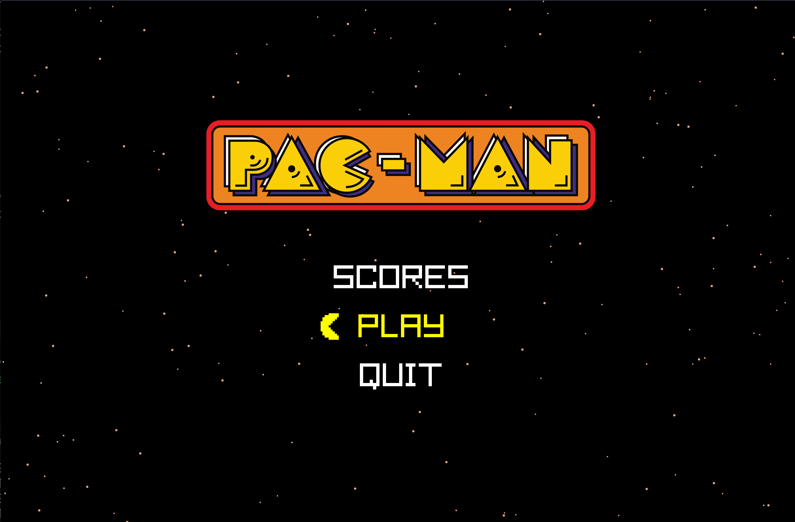
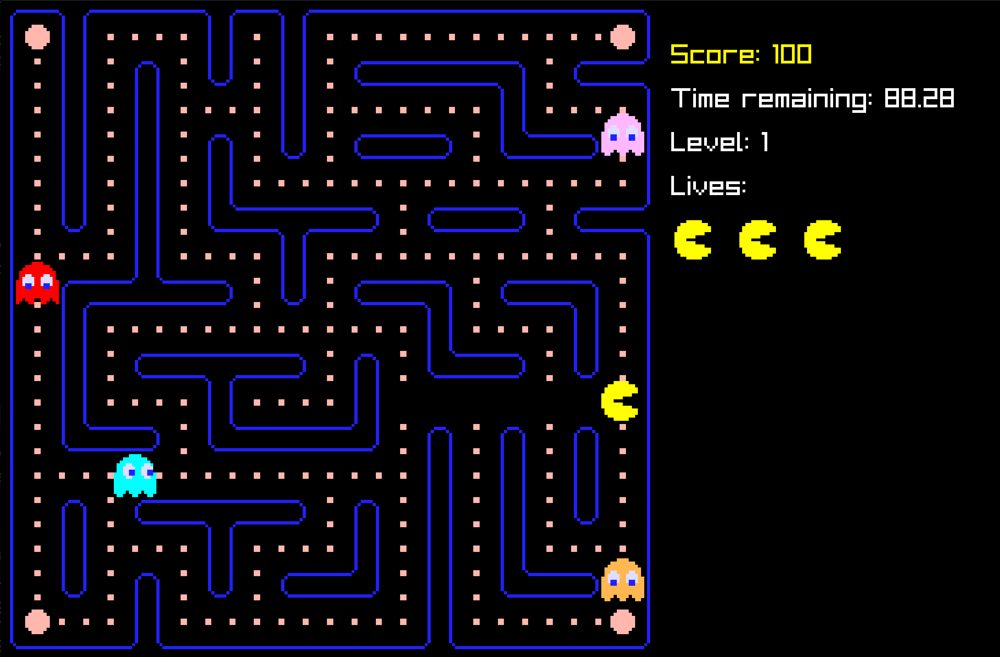
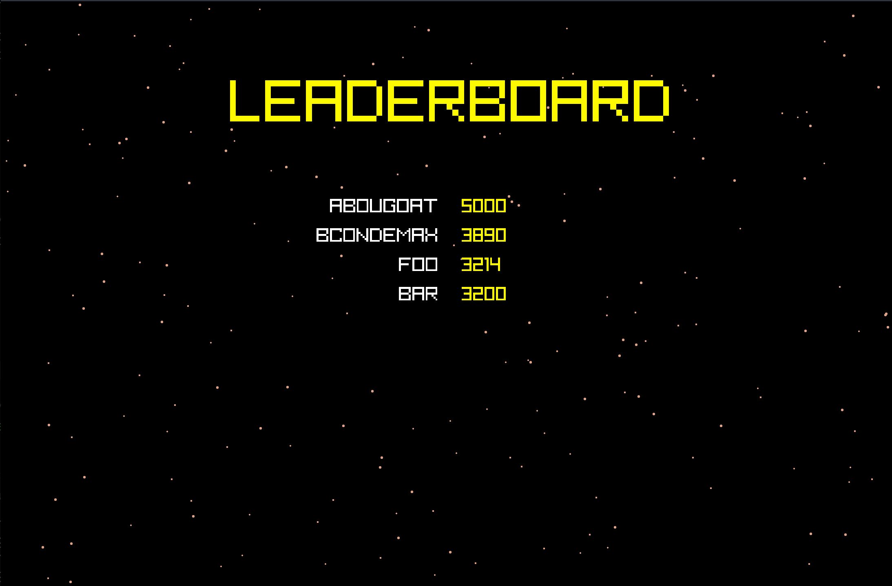
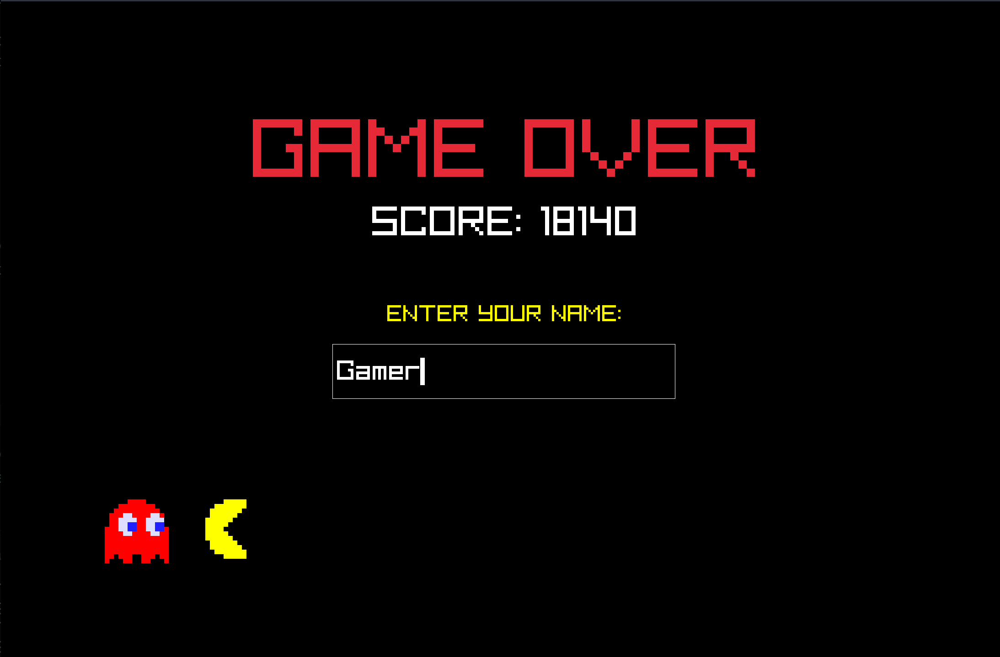
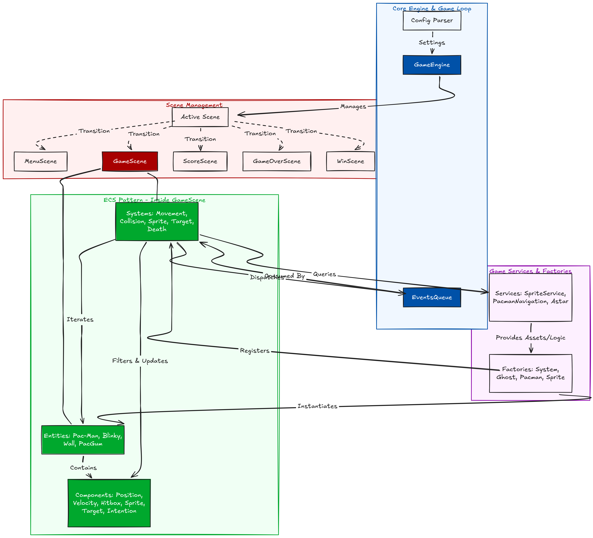

*This project has been created as part of the 42 curriculum by abounoua, bcondemi.*

# 🟡 Pac-Man: Custom ECS Engine in Python

## 📖 Description

This project is a modern, modular recreation of the classic arcade game **Pac-Man**, written entirely in Python using `pyray` (Raylib).

The goal of this project was to build a complete 2D game engine from scratch using the **Entity-Component-System (ECS)** architectural pattern, while successfully implementing complex gameplay mechanics such as dynamic maze generation, advanced A* pathfinding, and authentic ghost AI behaviors based on the original arcade game.

Players must navigate the maze, eat all the Pac-Gums (pellets) before the timer runs out, avoid the four unique ghosts, and use Super Pac-Gums to turn the tables and eat the ghosts. The game features multiple levels, cheat codes, and a persistent highscore system.

<table align="center">
  <tr>
    <td align="center">
      <br>
      <b>Home menu</b>
    </td>
    <td align="center">
      <br>
      <b>Pacman in-game</b>
    </td>
  </tr>
  <tr>
    <td align="center">
      <br>
      <b>Score menu (Leaderboard)</b>
    </td>
    <td align="center">
      <br>
      <b>Game Over screen</b>
    </td>
  </tr>
</table>

---

## 🏗️ General Software Architecture

The software architecture is heavily decoupled and relies on two main pillars: a custom **Entity-Component-System (ECS)** and a **Scene Management System**.

### 1. Entity-Component-System (ECS)

Instead of using complex Object-Oriented inheritance, the game logic is flattened:

* **Entities (`Entity`):** Simple containers identified by a string ID (e.g., `"pac_man"`, `"blinky"`, `"wall_x_y"`). They possess no inherent logic, only a list of attached components.
* **Components (`Component`):** Pure data classes. For example: `Position` (x, y), `Velocity` (speed), `Hitbox` (width, height, padding), `Sprites` (animation frames), and `Target` (ghost behavior targets).
* **Systems (`System`):** The actual logic processors. A system subscribes to entities that possess a specific combination of components. For instance, the `MovementSystem` updates the `Position` of any entity that also has a `Velocity` and an `Intention`; the `CollisionSystem` checks overlaps for entities with `Hitbox` and `Position`.

The project has been build around the idea of a generic Game engine which could be reused in multiple 2d games.



### 2. Scene Management & Game Loop

The `GameEngine` acts as the orchestrator. It manages an `EventsQueue` and delegates the rendering and updating to the active **Scene**:

* `MenuScene`: The main title screen with play and score options.
* `GameScene`: The core gameplay loop where the ECS systems (`SpriteSystem`, `MovementSystem`, `GhostTargeting`, etc.) are executed.
* `ScoreScene`: The leaderboard display.
* `WinScene` / `GameOverScene`: End-game screens handling player name input.

### 3. Clean Code & Best Practices

The codebase was designed with a strong emphasis on maintainability, readability, and software engineering best practices:

- **Strict Typing & Validation:** The entire codebase utilizes strict Python type hinting (`typing` module) to ensure robustness and facilitate IDE autocompletion. Furthermore, external data inputs (like `config.json` and `scores.json`) are strictly validated using `pydantic` models, preventing runtime crashes from malformed data.
- **Design Patterns:** Beyond the ECS pattern, the project extensively uses standard GoF design patterns:
  - **Factory Pattern:** Used heavily for instantiation logic (e.g., `GhostFactory`, `SystemFactory`, `SpriteFactory`, `PacmanFactory`) to keep the ECS composition clean and decoupled.
  - **Strategy Pattern:** Ghost AI heavily relies on this. A common `Behavior` abstract base class defines the interface, while specific implementations (`BlinkyBehavior`, `PinkyBehavior`, etc.) encapsulate the unique pathfinding strategies.
  - **Observer Pattern:** Used to automatically subscribe by ducktyping the entities to the system and ensure performance for subscriber retrieving.

- **Separation of Concerns:** The project is strictly divided into two packages: `pacman.engine` (the reusable core framework) and `pacman.game` (the specific Pac-Man logic). The engine has absolutely no knowledge of Pac-Man, Ghosts, or Pac-Gums.

- **Documentation:** Every class, method, and module is thoroughly documented with standardized docstrings, making the code accessible for future contributors or peer reviews.
---

## ⚙️ Implementation

Our implementation relies on a few key technical choices to ensure smooth gameplay and maintainability:

* **Graphics & Rendering:** Handled by `pyray` (Python bindings for Raylib). Sprites are dynamically extracted from sprite sheets using `Pillow` and `numpy` to handle alpha masking before being loaded into Raylib textures (`SpriteService`).
* **Collision Detection:** A custom AABB (Axis-Aligned Bounding Box) collision system handles entity interactions (eating Pac-Gums, ghost collisions).
* **Event Queue:** Input and collisions dispatch `Event` objects (`KeyPressEvent`, `CollisionEvent`). Systems read from the queue rather than checking states directly, preventing tight coupling.
* **Pathfinding (A*):** The `Astar` algorithm is implemented using Python's `heapq`. It calculates the shortest path from a ghost to its target node based on Manhattan distance heuristics.
* **Ghost AI:**
* **Blinky (Red):** Directly targets Pac-Man's exact tile.
* **Pinky (Pink):** Targets 4 tiles ahead of Pac-Man's current direction.
* **Inky (Blue):** Uses a complex vector projection using Blinky's position and 2 tiles ahead of Pac-Man.
* **Clyde (Orange):** Chases Pac-Man unless he gets within a specific radius, at which point he retreats to his corner.
* *State Machine:* Ghosts rotate through `CHASE`, `SCATTER`, and `AFRAID` states based on timers (`TargetSystem`).


---

## 🧩 Maze Generation

To ensure a unique experience while keeping the game playable, the maze generation utilizes the assigned **A-Maze-ing** (`mazegenerator`) package.

1. **Perfect Maze Generation:** The `MazeGenerator` creates a "perfect maze" (a maze with exactly one path between any two points and no loops) using a provided seed.
2. **Breaking Dead Ends (`break_dead_ends`):** A perfect maze is unplayable for Pac-Man because it is full of dead ends, guaranteeing the player gets trapped by ghosts. We implemented a custom algorithm that iterates horizontally and vertically over the perfect maze. It randomly destroys specific walls (using bitwise masking `~1, ~2, ~4, ~8`) while ensuring we don't create fully open 2x2 empty blocks (which would break the grid movement feel). This turns the perfect maze into a heavily looped, Pac-Man-friendly map.
3. **Matrix Conversion:** The bitwise maze data is parsed into a sprite matrix and a logic matrix (`PacmanCell.WALL`, `PacmanCell.PACGUM`) injected directly into the ECS.

---

## 🏆 Highscore

The game features a persistent highscore system that prompts the player for their name upon game over or victory.

**Implementation Details:**

* Scores are saved in a JSON file at `storage/scores.json`.
* Data validation and parsing are handled securely using `pydantic` (`ScoreEntry` schema).
* The system only retains and sorts the **Top 5** scores.

**Why this approach?**
We opted for JSON + Pydantic rather than a heavyweight database (like SQLite) because a leaderboard requires minimal storage. JSON is easily readable, easy to debug, and lightweight. Using `pydantic` guarantees that even if the JSON file is manually edited or corrupted, the application won't crash due to strict type validation during the loading phase.

---

## 🛠️ Configuration

The game loads its rules and parameters from a `config.json` file located at the root of the project. This allows easy tweaking of the game balance without modifying the source code. The file is parsed and strictly validated by `pydantic` in `parser.py`.

### Structure and Default Values:

* `seed` *(default: 42)*: The seed for the random maze generator (0-1000).
* `lives` *(default: 3)*: The number of lives the player starts with.
* `level_max_time` *(default: 200)*: The time limit in seconds to clear a level.
* `point_per_pacgum` *(default: 10)*: Score awarded for a regular pellet.
* `point_per_ghosts` *(default: 200)*: Score awarded for eating a scared ghost.
* `points_per_super_pacgum` *(default: 50)*: Score awarded for eating a power pellet.

*If `config.json` is missing or corrupted, the game will automatically fallback to these default values.*

---

## 🚀 Instructions

### Prerequisites

* Python 3.10 or higher.
* (Optional but recommended) A virtual environment manager like `UV` or `venv`.

### Installation


Install the required dependencies (`pyray`, `Pillow`, `pydantic`, `numpy`, `mazegenerator`):
```bash
make install

```


### Execution

Run the game using the main module:

```bash
make run
```

### Controls

* **Arrow Keys:** Move Pac-Man / Navigate Menus.
* **Enter:** Select / Submit Name.
* **Backspace:** Return to Menu (from game).
* **Cheat Codes:**
* Hold `Ctrl` to display cheat overlay.
* Press `C` to trap ghosts in their corners.
* Press `S` to instantly scare all ghosts.


---

## 📚 Resources

### References

* [The Pac-Man Dossier](https://pacman.holenet.info/): Essential documentation used to perfectly replicate the ghost AI personalities (Target tiles, Chase/Scatter modes, Pinky's overflow bug logic).
* [Raylib Documentation](https://www.raylib.com/cheatsheet/cheatsheet.html): Used heavily for window management, texture drawing, and input handling.
* [A* Pathfinding Introduction](https://www.redblobgames.com/pathfinding/a-star/introduction.html): Used as a reference to write our `Astar` solver.
* [Entity Component System Concepts](https://en.wikipedia.org/wiki/Entity_component_system): Used to design the engine's core architecture.

### AI Usage

Artificial Intelligence (LLMs) was used during the development of this project in the following ways:

* **Architecture Brainstorming:** Used to discuss and validate the structure of the custom ECS engine in Python, specifically how to decouple Systems and Events efficiently.
* **Docstrings & Typing:** AI was used to generate comprehensive, PEP 257 compliant docstrings and ensure strict static typing across the codebase.
* **Debugging:** Used to debug specific issues related to `Pillow` alpha channel extraction for sprite isolation, and Raylib texture memory management (preventing memory leaks when switching scenes).
* *Note: Core game logic, custom A* implementation, and ECS implementation were entirely written and assembled by the contributors.*